<a href="#d01">HUMAN</a> &nbsp;·&nbsp;
<a href="#d02">CHAPTERS</a> &nbsp;·&nbsp;
<a href="#d03">BUILT</a> &nbsp;·&nbsp;
<a href="#d04">TOOLBOX</a> &nbsp;·&nbsp;
<a href="#d05">RESEARCH</a> &nbsp;·&nbsp;
<a href="#d06">PULSE</a>

 

I'm **Shad**, an ICE undergrad at Daffodil International University and the founder of **X Dimension**, a studio that builds AI chatbots, automations and web apps. I like AI that runs offline, works on ordinary hardware, and takes boring work off real people's plates.

> *People talk about 3 or 4 dimensions. I want to work in all of them. That's the "X".*

 

| | Role | Where | What it actually means |
|:-:|---|---|---|
| ✦ | **Founder** | [X Dimension](https://xdimension.pro.bd) | AI chatbots, automations and custom web apps for businesses, plus AI training for teams |
| 🎓 | **Undergraduate** | ICE, Daffodil International University | Robotics & mechatronics, wireless communication, cryptography, and research |
| 🧠 | **AI/ML engineering track** | Phitron | Deep learning, model building and deployment |

 

<table>
<tr>
<td width="50%" valign="top">

 <b><a href="https://github.com/ssfshad/facultymind">FacultyMind</a></b>: an offline-first desktop AI assistant for Bangladeshi university teachers. It handles the boring parts of OBE accreditation: Bloom's tagging, CLO mapping and syllabus gaps. Entered in the International AI Builders Congress.
 <code>Electron</code> <code>Node.js</code> <code>Ollama</code> <code>SQLite</code> <code>transformers.js</code>
</td>
<td width="50%" valign="top">

 <b><a href="https://github.com/ssfshad/inkcast">InkCast</a></b>: turns an iPad or Android tablet into a wireless pen for your Windows screen. It's built for live screen annotation in tutorials and presentations, with a focus on keeping the lag low. Free and Apache-2.0.
 <code>Python</code> <code>Qt</code> <code>WebSockets</code> <code>scrcpy / adb</code>
</td>
</tr>
<tr>
<td width="50%" valign="top">

 <b><a href="https://github.com/ssfshad/hello-world">Hello World</a></b>: a local-first desktop journal for new coders. Log what you learn, practise it, and watch your streak grow.
 <code>Tauri</code> <code>Rust</code> <code>React</code> <code>TypeScript</code>
</td>
<td width="50%" valign="top">

 <b><a href="https://github.com/ssfshad/Plant-Recognition-App">Plant Recognition</a></b>: upload a photo of a leaf and it tells you which plant it is.
 <code>Python</code> <code>Computer vision</code> <code>Deep learning</code>
</td>
</tr>
<tr>
<td width="50%" valign="top">

 <b><a href="https://github.com/ssfshad/AI-Powered-Fault-Detection-in-WSN-s">AI-Powered Fault Detection in WSNs</a></b>: machine learning that spots faulty nodes in wireless sensor networks before they corrupt the data.
 <code>Python</code> <code>Machine learning</code> <code>IoT</code>
</td>
<td width="50%" valign="top">

 <b><a href="https://github.com/ssfshad/Stashboard">Stashboard</a></b>: one personal vault for passwords, files, notes and image collections.
 <code>JavaScript</code>
</td>
</tr>
</table>

 

  

 

| | What | Status |
|:-:|---|---|
| 🏅 | **Classifying Cerebral Palsy using Gait Recognition**: explainable AI (SHAP / LIME) on gait features for GMFCS levels · with Saheeba Anjum, supervised by Dipto Biswas, Dept. of ICE, DIU | **5th of 85 teams**, DIU Research Poster Competition 2026 · paper in progress |
| 📜 | Apna College **AI/ML** batch | Certified |
| 📜 | DataCamp **AI Analyst** | Certified |
| 📜 | **Prompt engineering**, several courses | Certified |
| ⏳ | Phitron **AI/ML engineering** | In progress |

 

<picture>
  <source media="(prefers-color-scheme: dark)" srcset="https://raw.githubusercontent.com/ssfshad/ssfshad/output/snake-dark.svg"/>
  <source media="(prefers-color-scheme: light)" srcset="https://raw.githubusercontent.com/ssfshad/ssfshad/output/snake-light.svg"/>
  
</picture>

 

Hand-drawn SVGs with embedded Poppins, Lora, DejaVu Sans Mono · the tesseract is a real 4D rotation, projected

